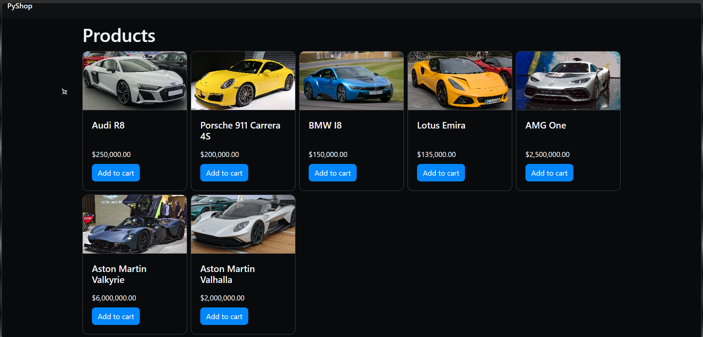

# learning-django-pyshop

> Learning project. Built while following Mosh Hamedani's Python tutorial
> (Code with Mosh), then adapted by me for current versions.

A small Django web app that shows products from a database in a responsive grid.



## What I changed from the tutorial
- Updated it for Django 6 and Bootstrap 6 (the tutorial uses much older versions)
- Built a responsive product grid (1 to 5 columns depending on screen size)
- Formatted prices and fixed layout, template and settings problems along the way

## Built with
Python, Django, Bootstrap

## How to run
```bash
python -m venv .venv
source .venv/Scripts/activate   # Git Bash on Windows
pip install -r requirements.txt
python manage.py migrate
python manage.py createsuperuser
python manage.py runserver
```
Products are added through the admin page at `/admin`.

## Notes
Used AI (Claude) as a tutor while debugging and for help with Bootstrap 6 syntax. I applied, tested and fixed the changes myself.